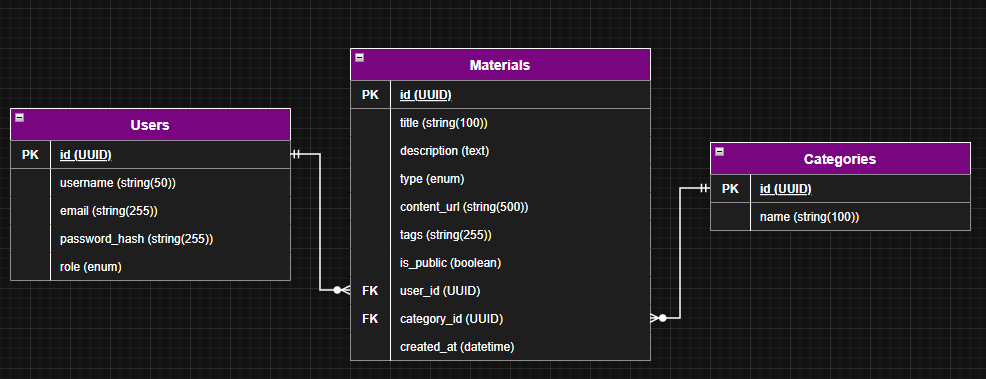

# Eesti_Oppematarjal
https://github.com/users/RasmusOlesk/projects/1/views/1

# Mis see on
Eesti keele põhine IT õppematerjali kogumik 

# Arendajad

Juri Sarki
Rasmus Olesk

### Arendaja keskkonna seadistamine ja projekti käivitamine

1. Klooni repositoorium
1. Ava kaust VS Code-iga või muu IDE-ga
1. Ava terminal (cmd) ja mine `backend` kausta
1. installi Node-i paketid:
`npm install`
1. Käivita arendus: `npm run dev`

Lõpetamiseks käsureal klahvikombinatsioon: `CTRL+C`

### Produktsiooni käivitamine

1. `backend` kaustas
1. Konstrueeri produktsiooni kood käsuga: `npm run build`
1. Käivita toodangu kood käsuga: `npm run start`
